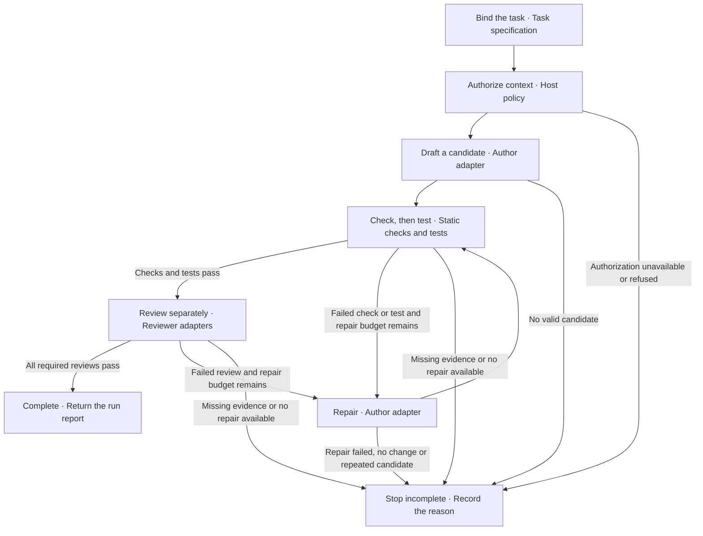
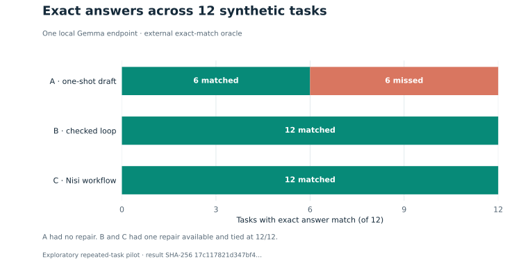
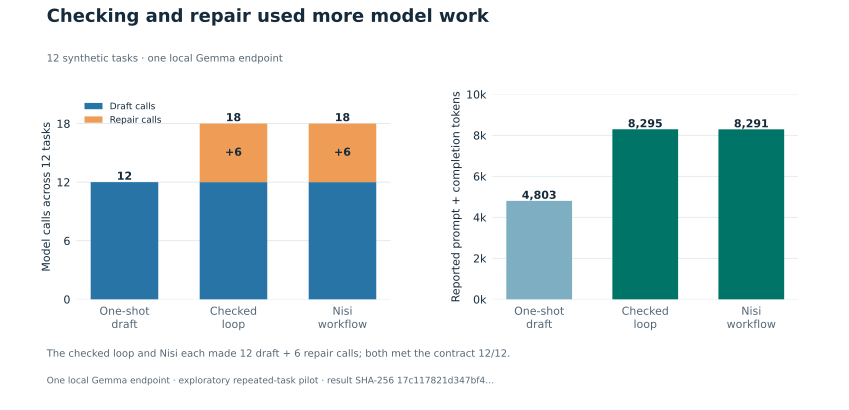
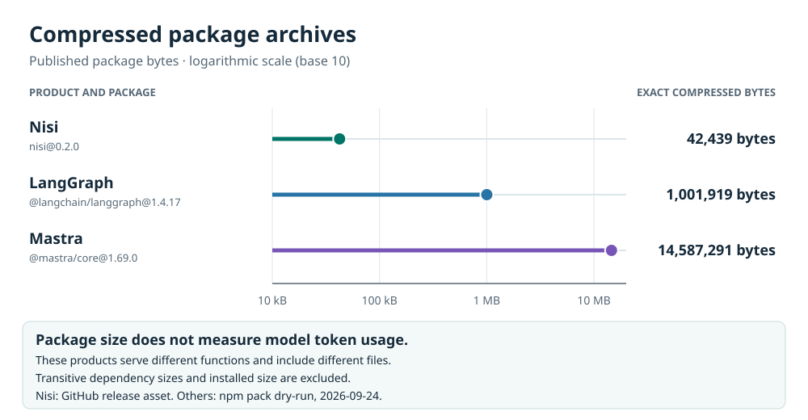

# Nisi

**A Node.js library and CLI for bounded AI-assisted coding workflows.**

Nisi coordinates drafting, checks, tests, review and a limited repair cycle. You
supply the task and the tool integrations; Nisi returns proposed file contents
and a report of what passed, what failed and why the run stopped. Fixed criteria
and a repair budget keep every attempt tied to the original request, and your
application decides whether to apply the result.

**Current release: v0.3.0.** It adds two optional features for local models, a
`reasoningEffort` setting and a Jev advisor ([details](#what-changed-in-v030)).
The CLI runs fixed demonstrations only; it does not run arbitrary repositories.
Applications use the workflow, journal and store APIs directly.

## Quick start

Install Node.js 22 or newer, then run the model-free demonstration:

```bash
git clone --branch v0.3.0 --depth 1 https://github.com/louiscalata/nisi.git
cd nisi
node bin/nisi.mjs demo
```

The demo drafts an intentionally incorrect JavaScript module, runs a syntax check
and two assertions, repairs it once, collects a separate review result, and
writes and verifies a report. It calls no model and treats the candidate as data;
it never imports it. A completed run prints:

```json
{
  "outcome": "COMPLETED",
  "code": null,
  "repairAttempts": 1,
  "reportStored": true,
  "modelCalls": 0
}
```

To run Nisi's own checks and tests, run `npm ci` and then `npm run check`. The demo does not need them.

To install without cloning, download `nisi-0.3.0.tgz` from the
[GitHub release](https://github.com/louiscalata/nisi/releases/tag/v0.3.0) and run
`npm install /path/to/nisi-0.3.0.tgz --ignore-scripts` in a new folder. Then run
`./node_modules/.bin/nisi demo` (macOS, Linux) or `.\node_modules\.bin\nisi.cmd demo`
(Windows PowerShell). Nisi is not published to the npm registry, and the archive
does not install models or start a model server.

## Command line

`node bin/nisi.mjs --help` lists the commands.

- `nisi demo` runs the fixed workflow above with no model call.
- `nisi local-model` runs one fixed JSON task against a configured loopback chat
  server (see [Local model adapters](#local-model-adapters)). It does not run
  model-generated programs or change a repository.

## What changed in v0.3.0

These are new since v0.2.1. All are optional: a request that does not set
`reasoningEffort` is byte-identical to v0.2.1, and the new module loads only if
you import it. See the [changelog](CHANGELOG.md) for the full list.

- **Jev analysis.** Jev is TypeSafe's System One model: a hosted service that
  returns typed answers and probabilities. Nisi never calls it. You pass a
  `judge({ state, questions })` function that does, so the key and transport stay
  with you, and anything you put in `state` (the task, and for the reviewer the
  candidate's files) goes to that service. `nisi/adapters/jev-advisor` exports
  `planWithJev`, which picks reasoning settings per task, and `createJevReviewer`,
  which records Jev's probability that a candidate meets every criterion. The
  reviewer is advisory unless created with `gate: true`; it was too weak to gate a
  run (AUC 0.78 on 31 labelled answers). See
  [Jev analysis](docs/local-models.md#jev-pre--and-post-analysis-optional).
- **`reasoningEffort` for local chat models.** Sent as `reasoning_effort`
  (`none`, `minimal`, `low`, `medium`, `high`). Invalid values are refused with
  `LOCAL_CHAT_REASONING_EFFORT_INVALID`.
- **Harder-task benchmark.** [`benchmarks/harder/`](benchmarks/harder/README.md)
  holds 16 frozen tasks and an opt-in runner for the Jev and reasoning figures. It
  is a source-checkout tool, not part of the package archive.

The v0.2 verification record covers the CLI, journal and store, which v0.3.0 does
not change. The v0.3.0 additions are covered by `tests/jev-advisor.test.mjs`,
`tests/local-chat.test.mjs` and `tests/harder-benchmark.test.mjs` and have no
separate verification record.

### Earlier: v0.2.1

A fix release for v0.2.0. The main changes:

- A required review cannot be skipped: a reviewer list that changed between reads
  could end a run `COMPLETED` with no review; a list with a hole is now `BLOCKED`
  with `REVIEWER_IDENTITY_INVALID`.
- Copies are bounded, so a shared object can no longer stall or crash the
  process: workflow snapshots refuse after 1,000,000 copied values
  (`INPUT_SIZE_LIMIT`), journal entries after 1,000,000 values or 64 Mi UTF-16
  units of copied strings (`ENTRY`), and typed arrays, Buffers and other
  non-plain objects are refused before their elements are listed.
- `writeSerializedJournal` refuses a symlinked destination (`SYMLINK`); the
  caller's `fs` must provide `lstatSync`.
- On POSIX the consent gate resolves paths the way the system opens them.
- Local-chat receipts keep the candidate the call sent.

## Use it in an application

Start from the complete [workflow example](examples/workflow.mjs) and replace its
fixed task and callbacks with your own. A task defines allowed file names,
acceptance criteria, a deadline, a repair budget and the required reviewer count.
`task` and the callbacks below are supplied by your application:

```js
import { runWorkflow } from 'nisi/workflow';

const report = await runWorkflow(task, {
  adapters: {
    authorizeContext: { authorize },
    author: { id: 'author.primary', draft, repair },
    staticChecks: { check },
    tests: { run },
    reviewers: [{ id: 'reviewer.primary', review }],
  },
});
```

Within this checkout the package import resolves to Nisi's workflow module. The
[Workflow API](docs/workflow-api.md) documents callback inputs, return schemas,
error outcomes and optional report storage. With `requireReportStore: true`, a run
that already timed out or was cancelled still offers its terminal report to the
store, using a fresh signal and the separate `storeTimeoutMs` budget (default
1000 ms).

Callbacks are trusted code, and storage acknowledgements are trusted host
reports. An application that executes generated code must provide isolation.
Your application decides whether to apply the candidate's file contents.

## Local model adapters

For model-generated JSON configuration, start a compatible local chat server
with JSON-schema output support. Replace both placeholders with different
configured model names:

```bash
node bin/nisi.mjs local-model \
  http://127.0.0.1:1234/v1/chat/completions AUTHOR_MODEL REVIEWER_MODEL
```

The example checks four fixed assertions and sends the candidate and results
to the reviewer. It evaluates JSON as data. Invalid arguments produce a setup
error before any model request. See the
[local model guide](docs/local-models.md)
for endpoint requirements, timeouts, and response validation. The server and
models are configured by the host application.

## Run journal and store

The **run journal** (`history/run-journal-v1.mjs`, import `nisi/history/run-journal`)
is an append-only, hash-chained record of what a run observed. A host can write
it, reopen it after a restart, and check it before relying on its rows. The
**journal store** (`history/run-journal-store-v1.mjs`, import
`nisi/history/run-journal-store`) moves a serialized journal to and from disk
through a caller-supplied `fs`.

**Journal**

- `createRunJournal(config)` validates every entry (fixed keys, identifier
  formats, safe integers, one of six states), reports duplicate and conflicting
  re-appends, and refuses invalid retries, revocations and project mismatches.
  Retries must be queued, refer to an eligible earlier entry in the same run and
  increase its attempt; terminal targets stay eligible, and hosts decide whether
  retrying a success makes sense. A second ID for the same retry target and
  attempt is refused with `RETRY_DUPLICATE`.
- Payload redaction is applied by path before anything is stored: the value is
  replaced with `[REDACTED]` before fingerprinting, so changes only to redacted
  values compare as duplicates. The same value reachable through another
  unredacted path is stored there. A missing redaction path is ignored.
- `list(now)` reports each entry's liveness: `REVOKED` for a revocation entry or
  a revoked entry; the final state of a `SUCCEEDED`, `FAILED` or `CANCELLED`
  entry; `EXPIRED` for any other entry past its TTL; `UNKNOWN` for a `RUNNING`
  entry without a fresh heartbeat; otherwise `QUEUED` or `RUNNING`. Each view also
  reports `expired` separately. Entries past their TTL or the configured maximum
  are retired by clearing their payloads while keeping their place in the chain.
- Retiring a payload recomputes the fingerprint from the stored null-payload
  entry, so re-appending the original content conflicts (`ID_CONTENT_MISMATCH`).
  `reopen` rejects older pruned rows whose fingerprints cannot be recomputed from
  their stored entries.
- `serialize()` produces canonical JSON lines with a header, a SHA-256 chain and
  a footer. `reopen(serialized)` rebuilds the journal and returns a recovery
  report (`COMPLETE`, `INCOMPLETE` for truncated input, or `INVALID`). A missing
  or invalid header returns no journal; a valid header with a damaged body returns
  a sealed journal that refuses appends.
- Time: `list`, `retain` and `serialize(now)` advance a time watermark and can
  permanently retire payloads, as do successful appends. Use one nondecreasing
  safe-integer millisecond clock; a future timestamp cannot be rolled back, even after reopen.
  `serialize()` without a time uses the last watermark, not wall time.
- Limits: history is capped at 10,000 records (`REFUSED` / `HISTORY_LIMIT` for new
  IDs; duplicates and conflicts still resolve) and entry nesting at 64 levels
  (`ENTRY`); entries are refused (`ENTRY`) after 1,000,000 copied values or 64 Mi
  UTF-16 units of copied strings. Reopen rejects larger histories. There is no
  serialized-byte limit, so hosts rotate journals and bound input bytes
  themselves. The module imports only `node:crypto` and `node:util`.

**Store**

- A write validates the chain, goes through an exclusive temp file in the same
  directory, syncs and reads back that file, renames it into place, syncs the
  directory and reads back the destination. A symlinked destination is refused
  with `SYMLINK` before the temp file is written and again before the rename, so
  the caller's `fs` must provide `lstatSync`.
- The store reports `committed` and `durable` separately; a write that landed
  without confirmed file and directory sync is never reported as durable. A read
  refuses truncated, non-canonical, malformed-UTF-8 or chain-broken files.
- Each write attempt uses its own temporary file name, so an orphaned temp file
  from a stopped process does not block an identical retry.
- `expectedPreviousSha256` detects stale **sequential** writes. It is not an
  atomic guard for concurrent writers or a continuity check: a matching digest
  permits replacement with any valid journal, including an empty journal or
  another project. Use one writer per journal and serialize writes in the host.
- `verified: true` means internal format and hash consistency, not authenticity.
  The unkeyed chain and footer can be rewritten together, so detecting malicious
  replacement needs a trusted digest or authentication outside the journal.

**Recovery.** The package has no recovery worker, and its exports are limited to
the declared runtime modules (older deep imports may no longer resolve). After a
restart a host calls `readSerializedJournal`, then `reopen`. For damaged input the
store returns `INVALID_JOURNAL` and refuses replacement with `EXISTING_INVALID`;
the host can read the raw bytes and call `reopen` for sealed recovery when the
header is valid. Preservation, quarantine and recovery to a new path are host
responsibilities. A stopped write may leave `journal.jsonl.<sha256>.<uuid>.tmp`
beside the journal; check its owner and destination before removing it. Journal
views and recovery reports carry `authorizing: false`: they record observations
and grant no authority.

## Architecture

The **Workflow Orchestrator** (`runWorkflow`) calls adapters in sequence and
validates their result records. An **adapter** is a callback object that connects
one workflow role to an application tool or model. Separate author and reviewer
IDs make responsibilities explicit; the host supplies trustworthy implementations.

### One run

An edit task follows this path. A repaired candidate must pass fresh checks,
tests and review. Cancellation or a deadline can stop the run at any stage.



Review mode starts with an existing candidate and runs authorization, checks,
tests and review without drafting or repair. The
[architecture guide](docs/architecture.md) defines workflow, pipeline, run, state,
stage status and final outcome.

### Components

| Component | Responsibility |
|---|---|
| Workflow Orchestrator | Sequence stages, validate evidence, limit repairs, return a run report |
| Local Chat Adapters | Send author and reviewer requests to a configured loopback HTTP endpoint |
| Jev Advisor | Optional: plan reasoning settings per task and record a Jev probability as an advisory review |
| File Access Policy | Admit file content under the separate Apple on-device destination contract |
| JSON Canonicalizer | Produce stable bytes and digests under Nisi's restricted integer-only JSON profile |
| Apple Foundation Models Adapter | Run and validate a native advisory helper in a compatible Apple environment |
| Static Analysis Check | Check selected direct call patterns in the JSON codec |
| Run Journal | Keep an append-only, hash-chained record of run observations with redaction, liveness and verified reopen |
| Journal Store | Write and read a serialized journal through a temp file, sync, read-back and rename, reporting durability honestly |

Nisi validates what adapters report. `COMPLETED` means the required stages
returned valid passing evidence; callback honesty and actual file access remain
host responsibilities. The host also owns applying changes and release decisions.

## Benchmarks

The benchmark tooling and graphs ship in the source checkout from v0.2.1
onward and are not in the package archive. The model-free benchmarks are below;
the [harder-task benchmark](benchmarks/harder/README.md) is the v0.3.0 addition
and calls a model.

### Token use in one local pilot

The [source-checkout benchmarks](benchmarks/value/README.md) exercise workflow
controls, mocked inference interfaces, and orchestration overhead. A separate
[exploratory local pilot](benchmarks/value/results/README.md) used one already
loaded Gemma model through Nisi's released loopback chat adapter. A match
required exactly one `answer.json` file whose JSON object had only an `answer`
key holding the expected value. All six one-shot outputs that failed this
contract contained the expected value without that wrapper. A handwritten
checked loop and Nisi each repaired those six shapes once and tied on all 12
tasks; their draft and repair request bytes matched per task.

The same 12 tasks had appeared in earlier exploratory runs, and server cache
behavior was not measured. Treat these counts as an integration check, not a
general accuracy estimate.

| Arm | Contract matches | Model calls (repairs) | Reported tokens |
|---|---:|---:|---:|
| Direct one-shot | 6 / 12 | 12 (0) | 4,803 |
| Handwritten checked loop | 12 / 12 | 18 (6) | 8,295 |
| Nisi workflow | 12 / 12 | 18 (6) | 8,291 |





The direct arm had no repair opportunity, while each checked arm could repair
once. These graphs show one local integration and the extra model work used by
checking and repair; they do not establish that Nisi outperforms the checked
loop or works with arbitrary inference systems. See the
[contract matches by task family](benchmarks/value/charts/task-families.svg),
[raw candidate and receipt rows](benchmarks/value/results/pilot-local-gemma-20260924.json),
and [study plan](benchmarks/value/LIVE-STUDY.md) for scope and next tests.

### Package footprint

The v0.2.0 npm-format archive was **42,439 bytes with 18 files**; v0.3.0 adds
one file, `adapters/jev-advisor.mjs` (19 files, size not re-measured here).
The source checkout also contains tests, docs, and benchmark evidence. The
chart compares pinned Node package archives, excluding dependency packages;
LangGraph.js and Mastra offer broader capabilities and use different packaging.
Package size is not the amount of context sent to a model and cannot establish
token savings. In the pilot above, Nisi reported just four fewer tokens than
the equally successful checked loop (0.048%), which is not a meaningful saving.



See the [measurement method and product comparison](benchmarks/value/COMPARISON.md)
for pinned sources, capabilities, and the paired study needed before any token
savings claim.

## Documentation

- [Workflow API reference](docs/workflow-api.md): task, candidate, callback and report contracts.
- [Architecture](docs/architecture.md): components, terminology and trust boundaries.
- [Local models and Jev](docs/local-models.md), [file access](docs/file-policy.md) and [Apple integration](docs/apple-foundation-models.md): integration setup and limits.
- [Harder-task benchmark](benchmarks/harder/README.md): the opt-in model benchmark behind the v0.3.0 figures.
- [v0.1 verification](docs/verification.md) and [v0.2 verification](docs/verification-v0.2.md): version-scoped results and limits.
- [Changelog](CHANGELOG.md): public changes by version.
- [v0.1 editable README manuscript](docs/editor): a standalone editor for the earlier README text.

## Support and license

Questions and reproducible reports are welcome in
[GitHub Issues](https://github.com/louiscalata/nisi/issues). See the
[contribution policy](CONTRIBUTING.md) and [security scope](SECURITY.md). Pull
requests are not currently accepted. Maintained by Louis Calata; licensed under
[Apache-2.0](LICENSE).

## Background

Nisi grew out of **initiate online code mode**, an assistant skill Louis uses to
organize coding work. Its rules became this library: fixed scope, defined
responsibilities, separate review and bounded repair. Codex and Claude were used
during development.
