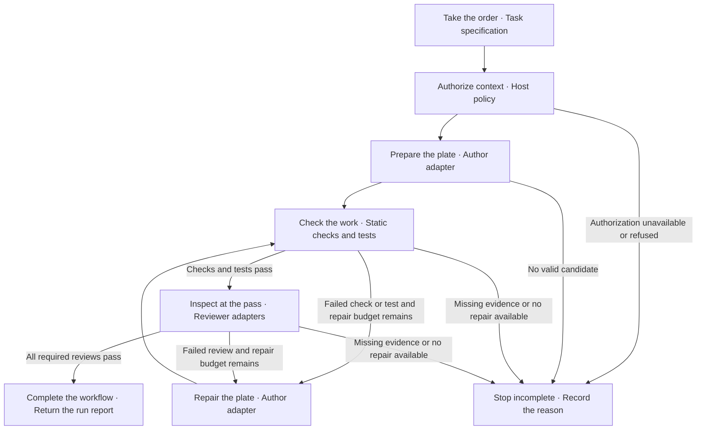

# Nisi v0.2

**A Node.js command-line tool and library for AI-assisted coding workflows.**

Use Nisi when your application needs to coordinate drafting, checks, tests,
review, and a limited repair cycle. You supply the task and tool integrations;
Nisi returns proposed file contents and a report showing what passed, what
failed, and why the run stopped. Fixed criteria and repair limits keep each
attempt tied to the original request.

**v0.3.0 is the current public CLI release**, which adds optional Jev analysis and a reasoning-effort option to v0.2.1. Its command runs a fixed workflow
demonstration or a fixed local-model JSON demonstration. Applications can use
the workflow, journal, and store APIs directly. This release does not run
arbitrary repositories from the command line. The [v0.1 verification
record](https://github.com/louiscalata/nisi/blob/main/docs/verification.md)
describes the earlier release. The [v0.2 verification record](https://github.com/louiscalata/nisi/blob/main/docs/verification-v0.2.md)
records the checks for this release and their limits.

## Quick start

Install Node.js 22 or newer, then run the fixed, model-free demonstration:

```bash
git clone --branch v0.3.0 --depth 1 https://github.com/louiscalata/nisi.git
cd nisi
node bin/nisi.mjs demo
```

The example drafts an intentionally incorrect JavaScript module, runs a syntax
check and two assertions, repairs it once, obtains a separate review callback's
result, and writes and verifies a report. It makes no model calls.
The completed demo prints:

```json
{
  "outcome": "COMPLETED",
  "code": null,
  "repairAttempts": 1,
  "reportStored": true,
  "modelCalls": 0
}
```

Run `npm ci` followed by `npm run check` to check the codec and run the test
suite. The package declares Node.js 22 or newer, and the check script validates
it directly. The [GitHub release](https://github.com/louiscalata/nisi/releases/tag/v0.3.0)
also provides an npm-format archive for local installation; Nisi v0.3.0 is not
published to the npm registry.

## Command line

From a source checkout, run `node bin/nisi.mjs --help` to see the supported
commands. An installed release archive provides the `nisi` executable.
`nisi demo` runs the same fixed workflow shown above, with no model call.
`nisi local-model` runs a fixed JSON-configuration task against a configured
loopback chat server. It does not execute model-generated programs or apply
changes to a repository. The host application remains responsible for any
broader coding task and for deciding whether to apply proposed files.

To use the downloadable `nisi-0.3.0.tgz` archive without cloning the source,
install it into a new project folder with
`npm install /path/to/nisi-0.3.0.tgz --ignore-scripts`. Run
`./node_modules/.bin/nisi demo` on macOS or Linux, or
`.\node_modules\.bin\nisi.cmd demo` in Windows PowerShell. The archive does not
install models or start a model server.

## Run journal and store

v0.2 adds the public `nisi` command, a **run journal**, and a disk store for it.
The journal is an append-only, hash-chained record of what a run observed. A host can write it,
reopen it after a process restart, and check it before relying on its rows.
These modules live under `history/`. This section describes v0.3.0;
[What changed in v0.3.0](#what-changed-in-v030) lists the differences from v0.2.1.
The [changelog](CHANGELOG.md) records changes by version;
results measured with a separate private adapter do not apply to this public package.

- **Run journal** (`history/run-journal-v1.mjs`, import `nisi/history/run-journal`).
  `createRunJournal(config)` validates every entry (fixed keys, identifier
  formats, safe integers, one of six states), reports duplicate and conflicting
  re-appends, refuses invalid retries, revocations, and project mismatches,
  applies the configured payload redaction before anything is stored, and
  retires entries past their TTL or beyond the configured maximum by clearing
  their payloads while keeping their place in the chain. `list(now)` reports
  each entry's liveness: `REVOKED` for a revocation entry or a revoked entry,
  the final state of a `SUCCEEDED`, `FAILED`, or `CANCELLED` entry, `EXPIRED`
  for any other entry past its TTL, `UNKNOWN` for a `RUNNING` entry without a
  fresh heartbeat, and otherwise `QUEUED` or `RUNNING`; each view also reports
  `expired` separately. `serialize()` produces canonical JSON lines with a
  header, a SHA-256 chain, and a footer;
  `reopen(serialized)` rebuilds the journal and returns a recovery report
  (`COMPLETE`, `INCOMPLETE` for truncated input, or `INVALID`). A missing or
  invalid header returns no journal. A valid header with a damaged body returns
  a sealed journal that refuses further appends. The
  module imports only `node:crypto` and `node:util`.
  The original value at each redacted path is replaced with the stored marker
  `[REDACTED]` before fingerprinting. Fingerprints and duplicate detection use
  this redacted entry, so changes only to redacted values compare as duplicates.
  Redaction is by path: the same value reachable through
  another unredacted path, including a second reference to a shared object, is
  stored there. A missing redaction path is ignored (v0.2.0 refused it with `REDACTION`).
  `append`, `list(now)`, and `retain(now)` can permanently retire payloads.
  `list` and `retain` advance the time watermark; successful appends do too.
  Use one nondecreasing safe-integer millisecond clock: a future timestamp
  cannot be rolled back, including after reopen. `serialize()` uses the last
  watermark, not wall time. Hosts must rotate histories and bound input bytes
  themselves; payload retention is not a complete memory or disk quota, and
  there is no serialized-byte limit.
  Retries must be queued, refer to an eligible earlier entry in the same run,
  and increase its attempt. Terminal targets, including `SUCCEEDED`,
  remain eligible; hosts decide whether retrying a success makes sense.
- **Journal store** (`history/run-journal-store-v1.mjs`, import `nisi/history/run-journal-store`).
  `writeSerializedJournal` and `readSerializedJournal` move a serialized
  journal to and from disk through a caller-supplied `fs`. A write validates
  the chain first, goes through an exclusive temp file in the same directory,
  syncs and reads back that file, renames it into place, syncs the directory,
  and reads back the destination. A destination that is a symlink is refused
  with `SYMLINK`, both before the temp file is written and again just before
  the rename, so the caller's `fs` must provide `lstatSync`. Each write attempt uses its own temporary filename, so an orphaned
  temporary file from a stopped process does not block an identical retry.
  `expectedPreviousSha256` detects stale **sequential** writes; it is not an
  atomic guard for concurrent writers or a history-continuity check. A matching
  previous digest permits replacement with any valid journal, including an
  empty journal or another project. Use one writer per journal and
  serialize writes in the host. The store reports `committed` and `durable`
  separately, so a write that landed without confirmed file and directory
  sync is never reported as durable. A read refuses truncated, non-canonical,
  malformed-UTF-8, or chain-broken files instead of returning partial data.
  `verified: true` means internal format and hash consistency, not authenticity.
  The unkeyed chain and footer can be rewritten together; detecting malicious
  replacement requires a trusted digest or authentication outside the journal.

The public package does not include a recovery worker. Package exports are
limited to the declared runtime modules; old undocumented deep imports may no
longer resolve. A host owns the journal
location outside the package and can call `readSerializedJournal` followed by
`reopen` after a restart for a valid stored journal. For damaged input the store
returns `INVALID_JOURNAL` and refuses replacement with `EXISTING_INVALID`.
A host can separately read the raw bytes and call `reopen` for sealed recovery
when the header is valid;
preservation, quarantine and recovery to a new path are host responsibilities.
A stopped write may leave a file named
`journal.jsonl.<sha256>.<uuid>.tmp` beside the journal. Inspect the owner and
destination before removing an orphan. Journal views and recovery reports carry
`authorizing: false`; they record observations and grant no authority.

## What changed in v0.3.0

These are new since v0.2.1. See [CHANGELOG.md](CHANGELOG.md) for the full list.

- **Jev pre- and post-analysis (optional).** `nisi/adapters/jev-advisor` exports
  `planWithJev` and `createJevReviewer`. Nisi never calls Jev itself: you pass a
  `judge({ state, questions })` function, so the key and transport stay with
  you. Pre-analysis chooses reasoning settings per task; the reviewer records
  Jev's probability that a candidate meets every criterion and is advisory
  unless created with `gate: true`. On 31 labelled answers it was too weak to
  gate a run (AUC 0.78). See [local models](docs/local-models.md).
- **`reasoningEffort` for local chat models.** Sent as `reasoning_effort`
  (`none`, `minimal`, `low`, `medium`, `high`); invalid values are refused with
  `LOCAL_CHAT_REASONING_EFFORT_INVALID`. Without it, requests are unchanged.
- **Harder-task benchmark.** `benchmarks/harder/` holds 16 frozen tasks and an
  opt-in runner behind the Jev and reasoning figures. It is a source-checkout
  tool, not part of the package archive.

## What changed in v0.2.1

These behaviors were new in v0.2.1, since v0.2.0. See [CHANGELOG.md](CHANGELOG.md) for the
full list.

- **Required review cannot be skipped.** The engine reads the reviewer list and
  its length once. A list that changed between reads could finish a run as
  `COMPLETED` with no review; a list with a hole now returns `BLOCKED` with
  `REVIEWER_IDENTITY_INVALID` instead of throwing.
- **Bounded copies.** Workflow snapshots stop after 1,000,000 copied values
  (`INPUT_SIZE_LIMIT`) and journal entries after 1,000,000 values or 64 Mi
  UTF-16 units of copied strings (`ENTRY`). An object shared across many paths
  used to stall or crash the process before input validation. Typed arrays,
  Buffers and other non-plain objects are refused before their elements are
  listed.
- **Symlinked journal destinations are refused.** `writeSerializedJournal`
  returns `SYMLINK` instead of replacing the link while the old target keeps
  its bytes. The caller's `fs` must provide `lstatSync`.
- **Paths resolve as the system opens them.** On POSIX the consent gate uses the
  system realpath, so `link/..` is judged by the file `open()` would read.
- **Local-chat receipts** keep the candidate the call sent, even if the caller
  changes the payload while the response is in flight.

- **Journal validation and retention.** Missing redaction paths are ignored,
  including null payloads. Pruning recomputes the fingerprint from the stored
  null-payload entry; a re-append with the discarded original payload conflicts.
  Reopen rejects older pruned rows whose fingerprints cannot be recomputed from
  their stored entries. A second ID for the same retry target and attempt is
  refused with `RETRY_DUPLICATE`.
  `append`, `list(now)`, `retain(now)`, and `serialize(now)` can permanently
  retire payloads. `list`, `retain`, and `serialize` advance the time watermark;
  successful appends do too. Use one nondecreasing safe-integer millisecond
  clock: a future timestamp cannot be rolled back, including after reopen.
  Omitting the time from `serialize()` uses the last watermark, not wall time.
  Retention scans only retained rows (at most `maxEntries` plus the new append);
  metadata and ID history have a separate 10,000-record ceiling. New IDs beyond
  it return `REFUSED` / `HISTORY_LIMIT`; duplicates and conflicts still resolve.
  Reopen rejects larger histories. Hosts must rotate journals before this limit
  and bound input bytes themselves; there is no serialized-byte limit. Entry
  copying refuses nesting deeper than 64 levels with `ENTRY` (entry root at
  depth zero).
- **Required terminal report storage.** With `requireReportStore: true`, a run
  already timed out or cancelled offers its terminal report to the store using
  a fresh signal and a separate bounded budget. The `runWorkflow` option
  `storeTimeoutMs` defaults to 1000 ms for this attempt. Optional storage and
  storage for other outcomes retain the run's deadline and cancellation behavior.
  Storage acknowledgements remain trusted host reports.
- **Fixed workflow example.** Its assertions recognize only the fixed
  `export const answer = 41;` or `42;` source shape as data; candidate source is
  never imported. `nisi demo` removes its temporary report after write/read-back
  verification. Running the example directly keeps the report and prints its
  path; programmatic callers can use `runExample({ keepReport: false })` for
  cleanup. Callbacks remain trusted code; an application that executes generated
  code must provide isolation.

## Use it in an application

Start with the complete [workflow example](examples/workflow.mjs).
Its test callback treats the candidate as data (v0.2.0 imported it). Replace its
fixed task and callbacks with your application's requirements and tools.
Callbacks are trusted code; an application that executes generated code must
provide isolation.
A task defines allowed file names, acceptance criteria, a deadline,
a repair budget, and the required reviewer count.

The integration has this shape; `task` and the callbacks below are supplied by
your application:

```js
import { runWorkflow } from 'nisi/workflow';

const report = await runWorkflow(task, {
  adapters: {
    authorizeContext: { authorize },
    author: { id: 'author.primary', draft, repair },
    staticChecks: { check },
    tests: { run },
    reviewers: [{ id: 'reviewer.primary', review }],
  },
});
```

Within this checkout, the package import resolves to Nisi's workflow module.
See the [Workflow API](docs/workflow-api.md)
for callback inputs, return schemas, error outcomes, and optional report storage.
Storage acknowledgements remain trusted host reports.
Your application decides whether to apply the candidate's file contents.

## Local model adapters

For model-generated JSON configuration, start a compatible local chat server
with JSON-schema output support. Replace both placeholders with different
configured model names:

```bash
node bin/nisi.mjs local-model \
  http://127.0.0.1:1234/v1/chat/completions AUTHOR_MODEL REVIEWER_MODEL
```

The example checks four fixed assertions and sends the candidate and results
to the reviewer. It evaluates JSON as data. Invalid arguments produce a setup
error before any model request. See the
[local model guide](https://github.com/louiscalata/nisi/blob/main/docs/local-models.md)
for endpoint requirements, timeouts, and response validation. The server and
models are configured by the host application.

## Architecture

The **Workflow Orchestrator** (`runWorkflow`) calls adapters in sequence and
validates their result records. An **adapter** is a callback object that connects
one workflow role to an application tool or model. Separate author and reviewer
IDs make responsibilities explicit; the host supplies trustworthy implementations.

In the kitchen analogy, the task is the order, permitted context is the
ingredients, and the candidate is the plate. The orchestrator is the sous chef
coordinating stations; the reviewer is the expo checking the plate at the pass.
A station can be ordinary code, a test process, or a model adapter.

### The Path of One Plate

An edit task follows this path. A repaired candidate must pass fresh checks,
tests, and review. Cancellation or a deadline can stop the run at any stage.



Review mode starts with an existing candidate and runs authorization, checks,
tests, and review without drafting or repair. The
[architecture guide](https://github.com/louiscalata/nisi/blob/main/docs/architecture.md)
defines workflow, pipeline, run, state, stage status, and final outcome.

### Components

| Component | Responsibility |
|---|---|
| Workflow Orchestrator | Sequence stages, validate evidence, limit repairs, return a run report |
| Local Chat Adapters | Send author and reviewer requests to a configured loopback HTTP endpoint |
| File Access Policy | Admit file content under the separate Apple on-device destination contract |
| JSON Canonicalizer | Produce stable bytes and digests under Nisi's restricted integer-only JSON profile |
| Apple Foundation Models Adapter | Run and validate a native advisory helper in a compatible Apple environment |
| Static Analysis Check | Check selected direct call patterns in the JSON codec |
| Run Journal | Keep an append-only, hash-chained record of run observations with redaction, liveness, and verified reopen |
| Journal Store | Write and read a serialized journal through a temp file, sync, read-back, and rename, reporting durability honestly |

Nisi validates what adapters report. `COMPLETED` means the required stages
returned valid passing evidence; callback honesty and actual file access remain
host responsibilities. The host also owns applying changes and release decisions.

## Benchmarks

The benchmark tooling and graphs are on `main`; the v0.2.0 tag and release
archive predate this source update.

### Token use in one local pilot

The [source-checkout benchmarks](benchmarks/value/README.md) exercise workflow
controls, mocked inference interfaces, and orchestration overhead. A separate
[exploratory local pilot](benchmarks/value/results/README.md) used one already
loaded Gemma model through Nisi's released loopback chat adapter. A match
required exactly one `answer.json` file whose JSON object had only an `answer`
key holding the expected value. All six one-shot outputs that failed this
contract contained the expected value without that wrapper. A handwritten
checked loop and Nisi each repaired those six shapes once and tied on all 12
tasks; their draft and repair request bytes matched per task.

The same 12 tasks had appeared in earlier exploratory runs, and server cache
behavior was not measured. Treat these counts as an integration check, not a
general accuracy estimate.

| Arm | Contract matches | Model calls (repairs) | Reported tokens |
|---|---:|---:|---:|
| Direct one-shot | 6 / 12 | 12 (0) | 4,803 |
| Handwritten checked loop | 12 / 12 | 18 (6) | 8,295 |
| Nisi workflow | 12 / 12 | 18 (6) | 8,291 |


The direct arm had no repair opportunity, while each checked arm could repair
once. These graphs show one local integration and the extra model work used by
checking and repair; they do not establish that Nisi outperforms the checked
loop or works with arbitrary inference systems. See the
[contract matches by task family](benchmarks/value/charts/task-families.svg),
[raw candidate and receipt rows](benchmarks/value/results/pilot-local-gemma-20260924.json),
and [study plan](benchmarks/value/LIVE-STUDY.md) for scope and next tests.

### Package footprint

The published v0.2.0 npm-format archive is **42,439 bytes with 18 files**.
The source checkout also contains tests, docs, and benchmark evidence. The
chart compares pinned Node package archives, excluding dependency packages;
LangGraph.js and Mastra offer broader capabilities and use different packaging.
Package size is not the amount of context sent to a model and cannot establish
token savings. In the pilot above, Nisi reported just four fewer tokens than
the equally successful checked loop (0.048%), which is not a meaningful saving.


See the [measurement method and product comparison](benchmarks/value/COMPARISON.md)
for pinned sources, capabilities, and the paired study needed before any token
savings claim.

## Documentation

- [Workflow API reference](docs/workflow-api.md) — task, candidate, callback, and report contracts.
- [Architecture](https://github.com/louiscalata/nisi/blob/main/docs/architecture.md) — components, terminology, and trust boundaries.
- [Local models](https://github.com/louiscalata/nisi/blob/main/docs/local-models.md), [file access](https://github.com/louiscalata/nisi/blob/main/docs/file-policy.md), and [Apple integration](https://github.com/louiscalata/nisi/blob/main/docs/apple-foundation-models.md) — integration setup and limits.
- [v0.1 verification](https://github.com/louiscalata/nisi/blob/main/docs/verification.md) and [v0.2 verification](https://github.com/louiscalata/nisi/blob/main/docs/verification-v0.2.md) — version-scoped results and limits.
- [Changelog](https://github.com/louiscalata/nisi/blob/main/CHANGELOG.md) — public changes by version.
- [v0.1 editable README manuscript](https://github.com/louiscalata/nisi/tree/main/docs/editor) — a standalone editor for the earlier README text.

## Support and license

Questions and reproducible reports are welcome in
[GitHub Issues](https://github.com/louiscalata/nisi/issues). See the
[contribution policy](https://github.com/louiscalata/nisi/blob/main/CONTRIBUTING.md)
and [security scope](https://github.com/louiscalata/nisi/blob/main/SECURITY.md).
Pull requests are not currently accepted. Maintained by Louis Calata; licensed
under [Apache-2.0](https://github.com/louiscalata/nisi/blob/main/LICENSE).

## Background

Nisi grew out of **initiate online code mode**, the assistant skill Louis uses
to organize coding work. Its portable rules became this library: fixed scope,
defined responsibilities, separate review, and bounded repair. The assistant
skill is optional. Codex and Claude were used during development.
