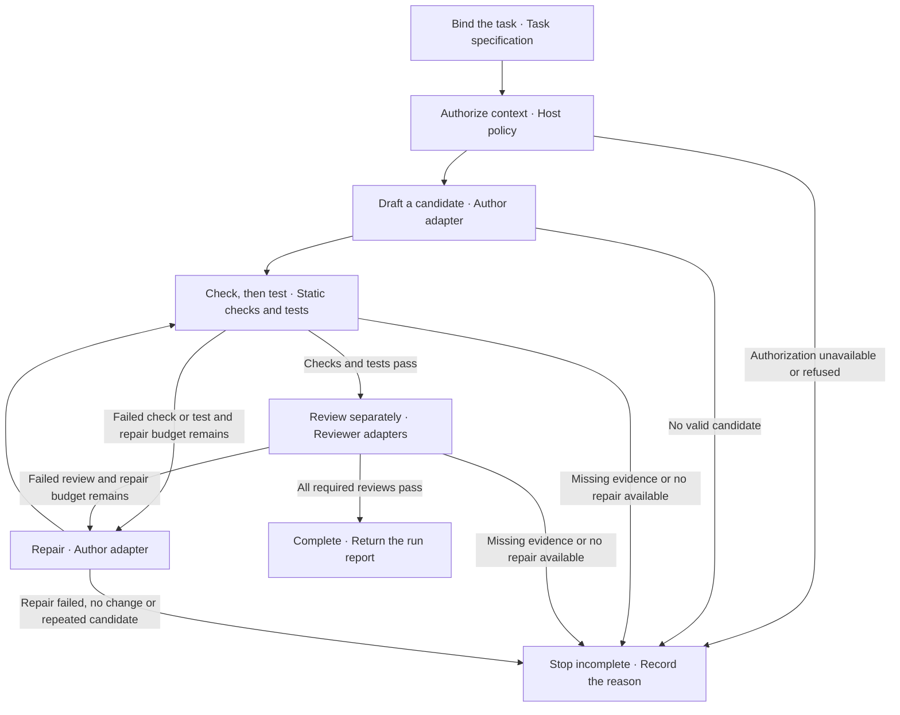

# Architecture

How Nisi separates workflow coordination from the application actions that read files, call models, run checks and tests, review and store reports. Back to the [documentation index](README.md).

The orchestrator captures task data, gives callbacks frozen snapshots, and validates structure, identity, stage order and evidence before it continues.

## Glossary

| Term | Meaning in Nisi |
|---|---|
| **Orchestrator** | `runWorkflow` in `workflow/engine.mjs`. It runs one task through the stages and returns the report. |
| **Workflow** | The rules and steps for completing a task, including authorization, stage order, acceptance criteria, repair policy, and stopping conditions. A run executes those rules. |
| **Run** | A single invocation of `runWorkflow`, identified by a fresh `runId` once setup validation passes (a setup refusal returns a `BLOCKED` report with `runId: null`), and represented by one immutable report. |
| **Stage** | One named step in a run, such as `authorizeContext`, `draft`, `staticChecks`, `tests`, `review`, or `repair`. Its record contains status, binding, and evidence. |
| **Status** | The result returned by an adapter: `PASS`, `FAIL`, `NOT_RUN`, or `UNAVAILABLE`. Repair uses its own set, `REPAIRED`, `NO_CHANGE`, `FAIL`, `NOT_RUN` and `UNAVAILABLE` (no `PASS`); draft returns candidate and evidence without a status field. |
| **Outcome** | The orchestrator's final run result. The seven values are defined under [Outcomes](#outcomes). |
| **Candidate** | A nonempty, normalized snapshot of changed relative file names and complete file contents. It has a stable fingerprint and an author ID. It is not a patch and does not apply itself. |
| **Callback** | A function your application supplies for one job, such as authorizing context, drafting, checking, testing, reviewing or storing a report. |
| **Adapter** | An application-supplied callback object for authorization, authoring, checks, tests, review, or storage. The orchestrator validates its declared identity and returned data; the host remains responsible for its behavior. |
| **State** | The run's current task, candidate, attempt number, stage records, outcome, and identity bindings. Input snapshots and returned reports are frozen so callbacks cannot mutate the orchestrator's view after capture. |

## Execution flow

The orchestrator carries one task through a fixed path:

1. **Intake and authorization:** normalize the task and ask the host whether
   the permitted context may be used.
2. **Draft:** in edit mode, the author returns a candidate snapshot and note.
3. **Static checks and tests:** evaluate the current candidate against the
   fixed criteria. Tests must report a positive executed-assertion count when
   they pass or fail. A failed static check skips the tests, and a failed test
   skips review.
4. **Review:** each required reviewer receives the candidate and fresh check
   and test records. Review mode uses a supplied candidate and reaches review only after
   authorization, checks, and tests.
5. **Repair or finish:** in edit mode, a failed check, test, or review may
   invoke the author within the repair budget, and the repaired candidate begins
   a fresh cycle. In review mode a failed stage ends the run as `FAILED` without
   repair.

The orchestrator binds every stage to a run ID, complete task fingerprint, repair
attempt, and candidate fingerprint. A stale or contradictory record stops the
run. A repeated candidate or explicit no-change repair produces `NO_PROGRESS`.

## Components

| Component | Module | Responsibility |
|---|---|---|
| Workflow Orchestrator | `workflow/engine.mjs` (`runWorkflow`) | Sequence stages, validate evidence, limit repairs, return a run report |
| Task and candidate contracts | `workflow/contracts.mjs` | Task and candidate normalization, deep-copy and freeze behavior, stable serialization, fingerprints, result schemas |
| File Access Policy | `policy/file-access.mjs` | Admit file content under the separate Apple on-device destination contract |
| JSON Canonicalizer | `serialization/canonical-json-v1.mjs` | Produce stable bytes and digests under Nisi's restricted integer-only JSON profile |
| Local Chat Adapters | `adapters/local-chat.mjs` | Send author and reviewer requests to a configured loopback HTTP endpoint |
| Jev Advisor | `adapters/jev-advisor.mjs` | Optional. Plans reasoning settings per task and records the probability from Jev (TypeSafe's hosted model, a paid API) as an advisory review |
| Apple Foundation Models Adapter | `adapters/apple-foundation-models.mjs` | Run and validate a native advisory helper in a compatible Apple environment |
| Static Analysis Check | `tools/check-side-effects.mjs` | Check selected direct call patterns in the JSON codec |
| Run Journal | `history/run-journal-v1.mjs` | Keep an append-only, hash-chained record of run observations with redaction, liveness and verified reopen |
| Journal Store | `history/run-journal-store-v1.mjs` | Write and read a serialized journal through a temp file, sync, read-back and rename, reporting durability honestly |

The application supplies all executable work through adapters. The orchestrator does
not read files, start processes, call a model endpoint, modify a candidate on
disk, commit, publish, or release. A report store is also an injected callback.
The Apple Foundation Models and local chat modules are adapters; neither is
required by the orchestrator.

Jev is hosted. The task, and for the reviewer the candidate's files, leave your machine when your `judge` function or, on main only, the built-in client (`adapters/jev-client.mjs`, needs `TYPESAFE_API_KEY`) calls it. A `judge` is a function you write that receives the `state` record Nisi builds and calls Jev. With neither, nothing is sent. See [Local models and Jev](local-models.md#jev-pre--and-post-analysis-optional).

## Architectural patterns

The implementation uses sequential orchestration, callback dependency injection,
runtime contract validation, and immutable snapshots.
State is held in memory during a run; Nisi has no checkpoint/resume API, durable
workflow scheduler, distributed workers, or configurable dependency graph.

## Evidence and trust

Every stage receives a binding containing `schemaVersion`, `runId`,
`taskFingerprint`, `attempt`, and `candidateFingerprint`. Stage-specific
evidence adds findings, reasons, reviewer identity, notes, or assertion
counts. The orchestrator rejects unknown fields, missing required fields, stale
bindings, duplicate reviewer IDs, and an author/reviewer identity match.

Nisi validates what adapters report. It does not prove that a callback did the work it claims. For example, a `PASS` test record is valid only when its evidence has positive executed and passed counts, but Nisi cannot independently observe the test process. Callbacks are trusted code, and storage acknowledgements and provider-reported model names and token usage are trusted host reports. File access, applying changes and release decisions stay with the host. An application that executes generated code must provide isolation.

## Outcomes

`COMPLETED` means every configured required stage supplied valid passing
evidence for the current candidate. It does not authorize applying files or
shipping a release.

- `FAILED`: a stage failure with no permitted repair, or a failed repair.
- `BLOCKED`: setup, evidence, availability, or required-storage problems.
- `CANCELLED` and `TIMED_OUT`: the reason progress stopped.
- `REPAIR_LIMIT`: exhausted corrections.
- `NO_PROGRESS`: a repeated candidate or no-change response.

The optional report store receives a frozen preliminary report and an exact
versioned digest. Its acknowledgement can set `reportStored`; the orchestrator does
not independently prove durable retention.

## Journal boundary

`history/run-journal-v1.mjs` and its disk store are separate recordkeeping APIs.
The workflow does not automatically write journal entries, and journal states
are not workflow outcomes. A host must supply any mapping or report-store adapter.
The journal's JSON-lines profile sorts keys by JavaScript UTF-16 code units;
it is distinct from the scalar-key-order canonical JSON v1 codec. Changing those
serializers would change stored bytes and digests and requires a format migration.

For the run journal, see [Run journal and store](run-journal.md). See also the
[Workflow API](workflow-api.md) for exact schemas, [File Access Policy](file-policy.md)
for host-controlled content admission, [Local Models](local-models.md) for loopback
adapter setup, and the [documentation index](README.md#verification-records) for
version-scoped verification records.
