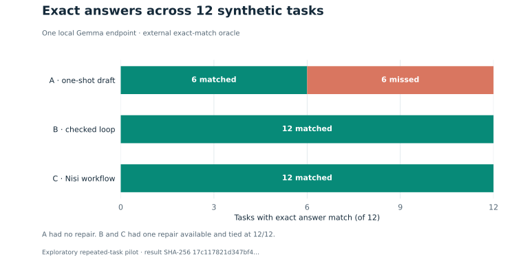
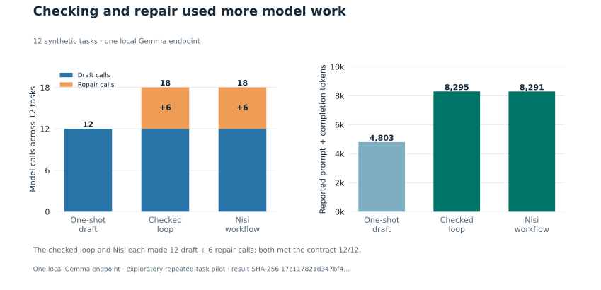
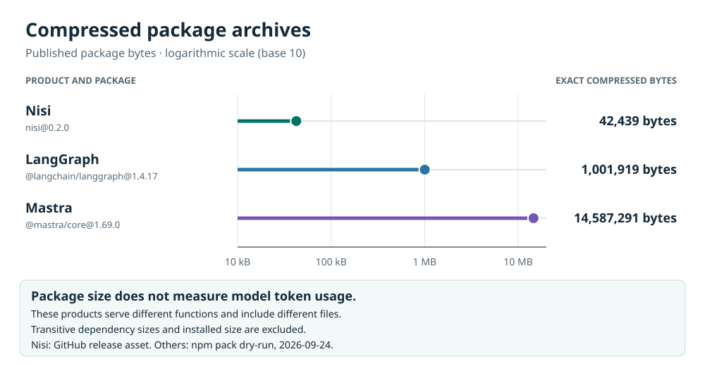

# Benchmarks: local pilot and package size

Measured results and method for Nisi. Back to the [documentation index](README.md).

The benchmark tooling and graphs ship in the source checkout from v0.2.1 onward and are not in the package archive. The control, interface and overhead benchmarks exercise workflow controls, mocked inference interfaces and orchestration overhead, and call no model. The local pilot below and the [harder-task benchmark](../benchmarks/harder/README.md) (new in v0.3.0) call a model, and both are opt-in. Harder-task results are in [Local models and Jev](local-models.md#measured-results).

## Local pilot: 12 tasks, one model

Both checked loops matched the output contract on 12 of 12 tasks against 6 of 12 for one-shot, and used about 3,500 more tokens. A handwritten checked loop and Nisi each repaired the six failing shapes once and tied on all 12 tasks; their draft and repair request bytes matched per task.

The pilot used one already loaded Gemma model through Nisi's released loopback chat adapter. Commands and setup are in the [source-checkout benchmarks](../benchmarks/value/README.md); the [pilot notes](../benchmarks/value/results/README.md) describe this run.

| Arm | Contract matches | Model calls (repairs) | Reported tokens |
|---|---:|---:|---:|
| Direct one-shot | 6 / 12 | 12 (0) | 4,803 |
| Handwritten checked loop | 12 / 12 | 18 (6) | 8,295 |
| Nisi workflow | 12 / 12 | 18 (6) | 8,291 |

### How a match was counted

A match required exactly one `answer.json` file whose JSON object had only an `answer` key holding the expected value. All six one-shot outputs that failed this contract contained the expected value without that wrapper. The direct arm had no repair opportunity, while each checked arm could repair once.

### How far to trust it

- The same 12 tasks had appeared in earlier exploratory runs, and server cache behavior was not measured.
- Treat these counts as an integration check, not a general accuracy estimate.
- The extra model work comes from checking and repair. The pilot does not show that Nisi outperforms the checked loop or works with arbitrary inference systems.
- Nisi reported four fewer tokens than the equally successful checked loop (0.048%), which is not a meaningful saving.

See the [contract matches by task family](../benchmarks/value/charts/task-families.svg), the [raw candidate and receipt rows](../benchmarks/value/results/pilot-local-gemma-20260924.json) and the [study plan](../benchmarks/value/LIVE-STUDY.md) for scope and next tests.

## Package footprint

The v0.3.0 archive is **51,377 bytes in 19 files**. The v0.2.0 archive was **42,439 bytes in 18 files**; the extra file is `adapters/jev-advisor.mjs`. The chart compares the pinned v0.2.0 archive with LangGraph.js 1.4.17 and Mastra core 1.69.0, excluding dependency packages. Those tools offer broader capabilities and use different packaging. Package size is not the amount of context sent to a model and cannot show token savings.

See the [measurement method and product comparison](../benchmarks/value/COMPARISON.md)
for pinned sources, capabilities, and the paired study needed before any token
savings claim.
