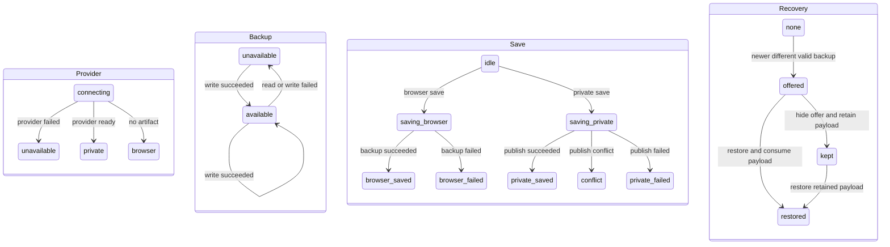

# Nisi v0.1 editable README manuscript

Open `index.html` or `index-typing-revision.html` in a browser. Both contain the
same standalone editor: 10 section text boxes, an About text box, a limited
Markdown preview, and **The Path of One Plate** diagram. No build step or model
server is needed to edit. GitHub's file viewer displays HTML source; download
the file and open it locally to use the editor.

Typing uses native textarea behavior. Previews refresh when a field loses focus.
The editor reads values for a local recovery copy without changing fields during
typing. Recovery is tied to the manuscript revision and offered explicitly.
Use **Download Markdown** and **Download editable copy** to retain portable files.
Browser storage is a convenience, not a replacement for those downloads.

The private `EditorState` keeps provider, backup, save and recovery independent.
Only `transition()` changes it; view tables retain the existing words and backup
success boolean. A successful backup clears a prior failure, including on a timer
tick; timer updates touch only the backup footer. The stored manuscript format is unchanged.



Each save result can start another save; diagram underscores denote enum hyphens.
Without a provider, startup uses `browser`; backup starts `available` and recovery
starts `none`. These regions coexist; private publication can succeed while browser backup fails.

`editor.js`, `editor.css` and `chrome.html` are the source. To rebuild from
`../README-draft.md` with new baselines:

```bash
python3 docs/editor/build-editor.py index.html
node docs/editor/check-editor.mjs ./index.html
```

The builder accepts an optional second argument pointing to a JSON state file
with `about` and `sections`. Each section has a stable `id`, `current` text and
`baseline` text. Its joined current text must exactly match `README-draft.md`.
Use that option when preserving editorial section IDs and original baselines.
The embedded `<script id="state" type="application/json">` in a saved editable
copy contains that state. Capture the user's latest live textarea values before rebuilding; an older export
may omit unsaved edits. The September 12 manuscript uses the prior published
wording as its comparison baseline.

The Markdown preview escapes user HTML and permits only HTTP, HTTPS and mailto
links. It supports a small Markdown subset and the fixed brigade flowchart
structure; it is not a full GitHub Markdown renderer. Unsupported diagram syntax
appears as code. The exported Markdown preserves the user's source text.

The About field is exported in the editable HTML, not in the README Markdown.
Updating GitHub's repository description is a separate publishing action.


This standalone editor and its manuscript preserve the v0.1 README text. They do
not represent the v0.2 README. Version-specific implementation and verification
records for the public v0.2 journal and store are maintained in the repository
root README, `docs/verification-v0.2.md`, and `CHANGELOG.md`. The v0.1 local-chat
documentation remains scoped to that workflow surface.
